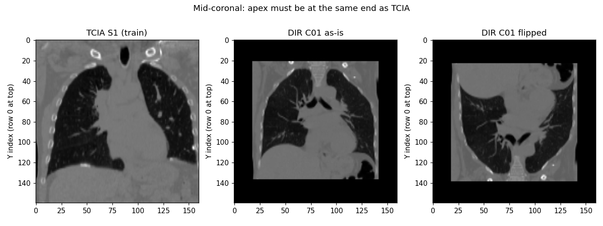

# Slide content: single-CT lung motion (24 Sep – 11 Oct 2026)

Simple slide-by-slide content. All errors are DIR-Lab landmark error (TRE300, mm; lower is better) unless noted. Figures in `figs/` (made by `make_slides.py` from the saved results).

---

## Slide 1 · Where we started (around 24 Sep)

- **Goal:** predict lung breathing motion from **one planning CT**.
- **Test:** DIR-Lab, 10 patients, 300 expert landmarks each; score = landmark error (TRE) in mm.
- **First model (TCIA3):** about 4.7 mm. "Make it move more" fixes (AmpHead, MagFT, MagMatch) gave small or no gains.

---

## Slide 2 · What was wrong: the scorer

- DIR-Lab CTs were **squeezed into the model's 160³ box** instead of resampled: voxels 1.5–3.1 mm and uneven instead of 2 mm; chests about 35% narrower than in training.
- **Brightness was scaled differently** from training.
- So the model was tested on **distorted images** it had never seen.

---

## Slide 3 · Fixing the scorer

- New scorer: **resample to 2 mm, centre on the lung, same brightness as training**.
- **Verified 4 ways:** Elastix round trip (within 0.002 mm), motion direction agreement, image match, inverse check.
- **Same model: 4.70 → 4.25 mm**, the biggest single gain. Every earlier conclusion was re-checked.

---

## Slide 4 · What the fixed scorer revealed

- Motion **direction** was mostly right (agreement with Elastix 0.32 → 0.85).
- The main error is **breath size**: shallow breathers get too much motion, deep breathers too little.
- With each patient's true breath depth: about **3.6 mm**. But **one CT cannot show breath depth** (lung size and shape do not predict it).

---

## Slide 5 · Why TCIA-lite (a fast test bench)

- A full run took **35–42 h**: too slow to test ideas.
- **TCIA-lite:** 65 scans, 4 patients held out, 40 epochs, **about 11 h**.
- Used to test one change at a time (network size, view, losses, labels).

---

## Slide 5b · Two training setups: "big" and "small"

Same network (UNetCRBDecoder, 1.07 M parameters) and base loss, different training.

| | **Big model (TCIA3.5)** | **Small model (TCIA-lite)** |
|---|---|---|
| Patients / scans | 20 / **82** | 16 / **65** (4 patients held out) |
| What it sees in training | **64³ patches** (16 per pair) | **whole lung 160³** (1 per pair) |
| Training | 100 epochs, constant learning rate | 40 epochs, learning rate lowered (cosine) |
| Augmentation | none | flip, shift, zoom, brightness, noise |
| Time per run | about 35 h | about 11 h |
| DIR-Lab (best) | **4.07** (old loss + flip, 2 seeds) | about 4.1–4.2 |

- Big model: more patients, best overall and on POPI. Small model: better on the deepest breather (C8) and stable across seeds (4.17 vs 4.16).
- They make **different mistakes**, so combining them helps (3.95 mm).

| Big model (64³ patches, old loss) | Small model (whole lung, hybrid) |
|---|---|
|  |  |

---

## Slide 5c · Bigger or smaller network?

| Network (small setup, 30 Sep) | Change | DIR-Lab |
|---|---|---|
| Baseline, 64³ patches | — | 4.74 |
| Half width (0.27 M) | smaller | 4.84 (worse) |
| One extra level (128³) | deeper | 4.59 |
| Whole lung 160³ (same 1.07 M) | sees more lung | **4.58** |

- **1.07 M is the right size.** Smaller learns less; deeper only helped because it saw more lung.
- Not underfitting: training error reached the label-noise floor. **What the model sees matters more than its size.**

**Case by case (early models):**

| Model | C1 | C2 | C3 | C4 | C5 | C6 | C7 | C8 | C9 | C10 | **Mean** | C1–5 | C6–10 |
|---|---|---|---|---|---|---|---|---|---|---|---|---|---|
| No motion | 3.89 | 4.34 | 6.94 | 9.83 | 7.48 | 10.89 | 11.03 | 14.99 | 7.92 | 7.30 | **8.46** | 6.50 | 10.43 |
| TCIA3 (fixed scorer) | 2.83 | 2.05 | 3.04 | 3.71 | 3.79 | 4.51 | 6.17 | 9.15 | 3.54 | 3.67 | **4.25** | 3.08 | 5.41 |
| Lite 64³ patches | 2.89 | 2.18 | 3.44 | 4.72 | 4.34 | 4.71 | 6.77 | 9.22 | 5.16 | 3.94 | **4.74** | 3.51 | 5.96 |
| Lite half width | 2.20 | 2.01 | 3.37 | 5.24 | 4.72 | 5.20 | 7.30 | 9.91 | 4.71 | 3.77 | **4.84** | 3.51 | 6.18 |
| Lite deeper 128³ | 2.49 | 1.91 | 2.87 | 5.43 | 5.01 | 4.20 | 6.31 | 9.71 | 4.49 | 3.49 | **4.59** | 3.54 | 5.64 |
| Lite whole lung 160³ | 2.98 | 2.49 | 2.88 | 4.33 | 5.08 | 4.88 | 6.83 | 8.68 | 3.99 | 3.62 | **4.58** | 3.55 | 5.60 |

---

## Slide 6 · Ideas that did not work

- Push-style labels, re-made labels, brightness matching, EPE loss, combining old models: each **less than 0.1 mm**.
- Conclusion: the model learns **Elastix very well, including Elastix's mistakes** (training error at the label-noise floor).

---

## Slide 7 · Why the hybrid loss

- **Problem:** the model only copies Elastix, so it copies Elastix's errors.
- **Idea from the literature** (RMSim; noisy-label work): also check **whether the images actually line up**.
- **Hybrid loss = motion error + image match + smoothness.** The image signal does not share Elastix's mistakes.

---

## Slide 8 · How the weights were chosen (an educated guess)

- **Loss = motion + 10 × image + 0.1 × smoothness.**
- Rule of thumb: make each part about the same size at the start (image ≈ 0.02 × 10 ≈ 0.2, close to motion ≈ 0.25; smoothness a light touch).
- **Fixed before training, never tuned on DIR-Lab** (tuning on the test set would inflate the result).
- Checked later: **weight 30 was worse** (4.34 vs 4.17), so 10 stayed.

---

## Slide 9 · Why first-order smoothness, not second-order

| | **First-order** (used) | **Second-order (bending energy)** |
|---|---|---|
| Penalises | sudden changes between neighbours | bending / curving of the motion |
| Even stretch (lung expanding) | penalised a little | free |
| Typical in | deep-learning registration (VoxelMorph) | B-spline registration (Elastix) |

- Chosen as a **simple, standard, stable default** with a **light weight (0.1)**, only to stop jagged motion.
- **Not tested:** second-order might suit breathing (smooth stretching) slightly better; expected effect small.

---

---

## Slide 10 · Hybrid loss on the small model: it works, twice

- Small model (whole lung): **4.47 → 4.17 mm** (seed 1) and **4.16 mm** (seed 2), 7/10 and 9/10 cases better.
- First change in the project to pass the fixed rule (> 0.1 mm better, ≥ 7/10 cases).
- But on POPI the small hybrid was **not** better (4.80 / 5.05 vs 4.73 old loss).

---

## Slide 11 · Hybrid loss on the big model: one lucky seed

- Seed 1 looked great: **3.87 mm** with flip. Seed 2: **4.37 mm**.
- Averaged over seeds: hybrid 4.12 vs old loss **4.07**, no improvement (16-patient test +0.02 mm, p = 0.46).
- Big-model hybrid seeds differ by **0.5 mm**; old loss only 0.1 mm. Likely causes: 64³ patches (image check sees little lung, padded edges) and a constant learning rate.
- **Lesson:** always run a second seed before claiming a gain.

---

## Slide 12 · Making the result stable

- Averaging the last 10 epochs' weights: helps the old loss a little (−0.08 mm), does not fix the hybrid seed gap.
- **Combining 2 small + 2 big models** (fixed before scoring): **3.95 mm DIR-Lab, 4.53 mm POPI**. Small and big models make different mistakes.

---

## Slide 13 · Local NCC: promising on paper, tiny in practice

- Check 1: local NCC notices motion errors much better than plain image difference (rank correlation 0.84–0.89 vs 0.50–0.65), but is noisy.
- Check 2: moving toward the true landmark motion lowers local NCC by **40%** vs 8.5% for plain difference.
- Check 3 (5-epoch top-up vs matched control): **−0.02 mm DIR-Lab, 0.00 POPI**. Not kept.

---

## Slide 14 · Label quality matters

- Adding the 4 held-out patients (82 scans) made the small model **worse** (4.16 → 4.50).
- Their Elastix labels are noisier (forward-backward error +17%); one scan (S29) is clearly bad (folding +4.2 SD).
- **Removing 4 flagged scans** (78 scans): 4.27 DIR-Lab and the **best small-model POPI (4.73)**.

---

## Slide 15 · X-ray models (VoxelMap): better data helps, but not enough

- **A2:** VoxelMap trained on 9 SPARE patients, tested zero-shot: **7.12 mm** (weights found and re-verified).
- **A2-TCIA:** same network and settings, trained on 82 TCIA scans: **5.14 mm**.
- Still worse than the single-CT model (**4.07**) on every case, most on the big scans (C6–10: 7.13 vs 5.52).
- Likely reason: this variant only sees the two X-rays, **never the CT**, so it cannot use anatomy or scan size.

---

## Slide 16 · Two CTs and the literature

- With **two CTs**, scaled Elastix (no training) gives **2.0 mm** (2.35 on C6–10), beating the published physics model (Fuerst et al., 3.88).
- So knowing breath depth takes the error from about 4–5 mm to about 2 mm: **missing depth is the main cost of one CT**.
- Literature: no method found that predicts from **one CT without a breathing signal** and reports DIR-Lab/POPI landmark error. Closest: Kanamuro et al. 2025 (one CT, private data, no landmarks).

---

## Slide 17 · Summary

- **Best single model:** 4.07 mm DIR-Lab, 4.57 mm POPI (2 seeds). **Pre-set combination:** 3.95 / 4.53 mm.
- About **half of the motion error removed** from one CT, in the range of methods that need a breathing signal (3.3–4.2 mm).
- What helped: fixing the scorer, flip averaging, combining models, clean labels. Loss changes: no reliable gain.
- **Limit: breath depth is invisible in one CT.** Deep breathers (C8) carry most of the error.

## Appendix A · Small model, case by case (epochs 36–40)

| Model | C1 | C2 | C3 | C4 | C5 | C6 | C7 | C8 | C9 | C10 | **Mean** | C1–5 | C6–10 |
|---|---|---|---|---|---|---|---|---|---|---|---|---|---|
| Small, old loss (65 scans) | 2.37 | 3.03 | 3.14 | 4.26 | 4.48 | 4.06 | 6.23 | 8.83 | 4.38 | 3.93 | **4.47** | 3.45 | 5.49 |
| Small, hybrid seed 1 | 2.09 | 2.43 | 2.84 | 3.73 | 3.90 | 4.19 | 6.66 | 7.90 | 3.97 | 4.00 | **4.17** | 3.00 | 5.34 |
| Small, hybrid seed 2 | 2.02 | 2.39 | 3.06 | 3.91 | 4.48 | 4.19 | 6.17 | 7.61 | 3.91 | 3.90 | **4.16** | 3.17 | 5.15 |
| Small, hybrid all 82 scans | 2.09 | 2.23 | 2.85 | 4.03 | 4.46 | 5.48 | 6.61 | 9.07 | 4.23 | 3.90 | **4.50** | 3.13 | 5.86 |
| Small, hybrid 78 clean scans | 1.95 | 2.51 | 3.17 | 3.14 | 4.22 | 4.54 | 6.23 | 9.03 | 4.23 | 3.63 | **4.27** | 3.00 | 5.53 |
| Small, old loss all 82 | 2.44 | 2.18 | 2.81 | 3.62 | 3.80 | 4.97 | 7.21 | 8.91 | 3.97 | 3.96 | **4.39** | 2.97 | 5.80 |

## Appendix B · Big model and final results, case by case (epochs 96–100, 2-seed mean)

| Model | C1 | C2 | C3 | C4 | C5 | C6 | C7 | C8 | C9 | C10 | **Mean** | C1–5 | C6–10 |
|---|---|---|---|---|---|---|---|---|---|---|---|---|---|
| Big, old loss | 2.19 | 1.91 | 2.57 | 3.77 | 4.03 | 4.72 | 5.88 | 9.57 | 4.07 | 3.44 | **4.21** | 2.89 | 5.53 |
| Big, hybrid loss | 2.26 | 2.16 | 2.72 | 3.48 | 4.20 | 4.99 | 6.05 | 9.66 | 3.86 | 3.51 | **4.29** | 2.96 | 5.62 |
| **Big, old loss + flip (best single)** | 1.97 | 1.87 | 2.44 | 3.38 | 3.46 | 4.97 | 6.01 | 9.33 | 3.93 | 3.34 | **4.07** | 2.62 | 5.52 |
| Big, hybrid + flip | 2.03 | 2.01 | 2.50 | 3.35 | 3.49 | 5.07 | 6.10 | 9.30 | 3.72 | 3.63 | **4.12** | 2.68 | 5.56 |
| Pre-set combination (2 small + 2 big, flip) | 1.67 | 1.85 | 2.45 | 3.44 | 3.66 | 4.51 | 6.17 | 8.51 | 3.83 | 3.37 | **3.95** | 2.61 | 5.28 |

POPI (6 patients, 2-seed mean): old loss + flip **4.57** mm; hybrid + flip 4.54 mm.

## Appendix C · X-ray (VoxelMap) models vs single CT, case by case

| Model | C1 | C2 | C3 | C4 | C5 | C6 | C7 | C8 | C9 | C10 | **Mean** | C1–5 | C6–10 |
|---|---|---|---|---|---|---|---|---|---|---|---|---|---|
| A2: X-ray model, SPARE 9 patients | 3.78 | 4.36 | 6.62 | 8.14 | 6.08 | 8.53 | 8.87 | 13.00 | 7.24 | 4.63 | **7.12** | 5.79 | 8.45 |
| A2-TCIA: same model, TCIA 82 scans | 2.23 | 2.35 | 3.56 | 3.82 | 3.81 | 5.84 | 7.69 | 10.94 | 6.50 | 4.71 | **5.14** | 3.15 | 7.13 |
| Single-CT best (for comparison) | 1.97 | 1.87 | 2.44 | 3.38 | 3.46 | 4.97 | 6.01 | 9.33 | 3.93 | 3.34 | **4.07** | 2.62 | 5.52 |

A2-TCIA = epochs 46–50 mean, zero-shot, same network and settings as A2 (concatenated, sees only the two X-rays, not the CT).
