# Slide content: single-CT lung motion (24 Sep – 11 Oct 2026)

Simple slide-by-slide content. All errors are DIR-Lab landmark error (TRE300, mm; lower is better) unless noted. Figures in `figs/` (made by `make_slides.py` from the saved results).

---

## Slide 1 · Where we started (around 24 Sep)

- **Goal:** predict lung breathing motion from **one planning CT**.
- **Test:** DIR-Lab, 10 patients, 300 expert landmarks each; score = landmark error (TRE) in mm.
- **First model (TCIA3):** about 4.7 mm. "Make it move more" fixes (AmpHead, MagFT, MagMatch) gave small or no gains.

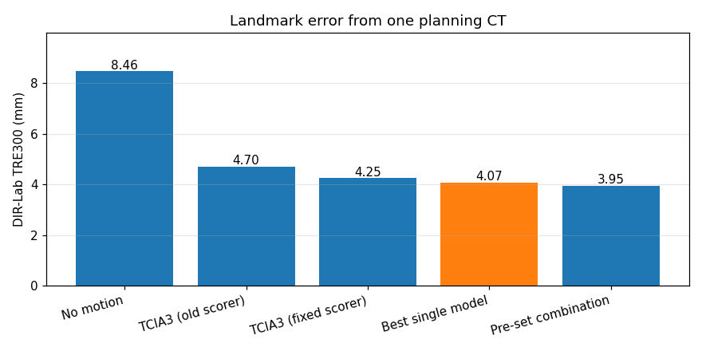

---

## Slide 2 · What was wrong: the DIR-Lab scorer

*Applies to every TCIA-trained model scored on DIR-Lab before 29 Sep (TCIA3, TCIA3.5 and the fine-tunes).*

- **Found in a code audit (29 Sep).** Warning sign: predicted motion was **too small** (0.65 of the real size; C08 0.44), and "move more" fixes (MagFT, MagMatch, AmpHead) did not help.
- DIR-Lab CTs were **squeezed or stretched into the model's 160³ box** instead of resampled: voxels 1.5–3.1 mm and uneven instead of 2 mm; chests up to about 35% narrower (C06–C10) or wider (C01–C05) than in training.
- **Brightness was scaled differently** from training (DIR-Lab came out much brighter).
- So the model was tested on **distorted images** it had never seen. The model and its training data were fine.

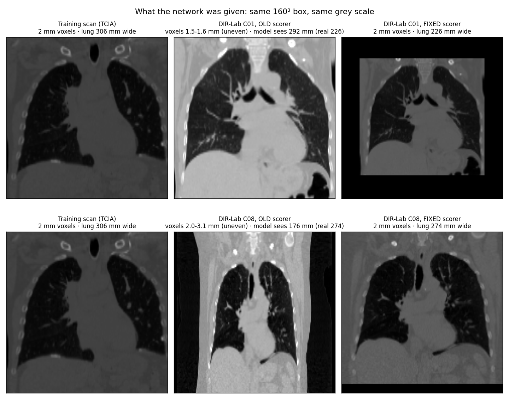

*Black edges on the fixed C01 = air outside the scan (C01 covers ~250 mm of the 320 mm box). C08 (scanned ~500 mm wide) is cropped at the arms; all lung and all 300 landmarks stay inside.*

---

## Slide 3 · Fixing the scorer

- New scorer: **resample to 2 mm, centre on the lung, same brightness as training**.
- **Verified 4 ways:** Elastix round trip (within 0.002 mm), motion direction agreement, image match, inverse check.
- **Same model: 4.70 → 4.25 mm**, the biggest single gain. Every earlier conclusion was re-checked.

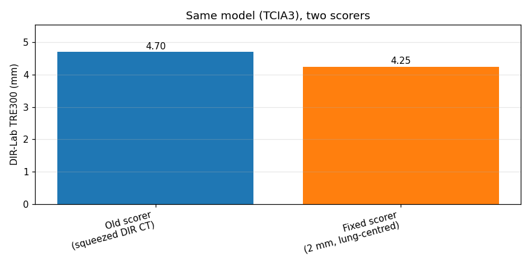

---

## Slide 4 · What the fixed scorer revealed

- Same model, same measurement, all 10 cases: **direction 0.80 → 0.84** (already mostly right), **motion size 0.65 → 0.78** (this is what the fix changed).
- C01 (shallow breather) goes from 1.03 to 1.37 of the real size (too big); C08 (deep breather) stays at 0.39–0.44 (too small).

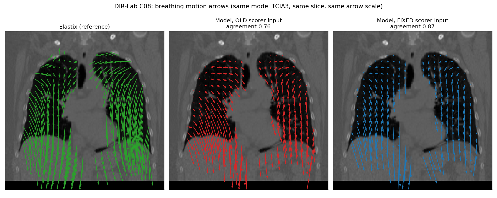

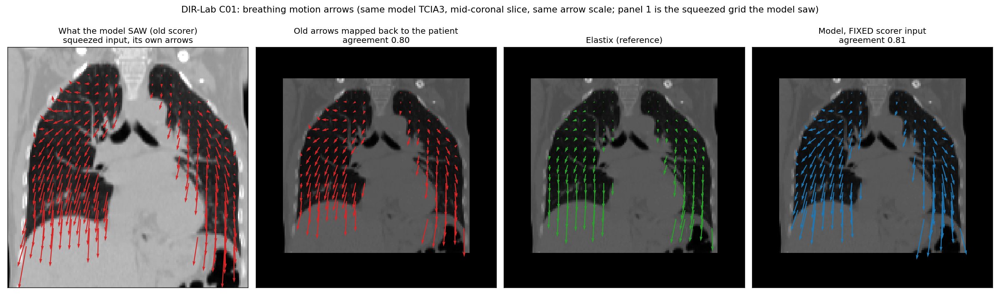

- The main error is **breath size**: shallow breathers get too much motion, deep breathers too little.
- With each patient's true breath depth: about **3.6 mm**. But **one CT cannot show breath depth** (lung size and shape do not predict it).

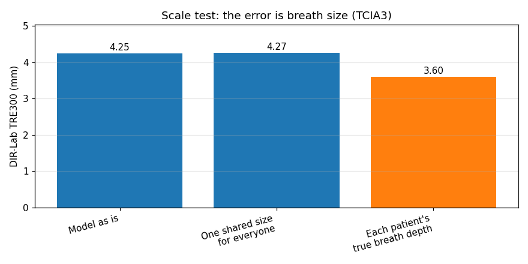

---

## Slide 5 · Why TCIA-lite (a fast test bench)

- A full run took **35–42 h**: too slow to test ideas.
- **TCIA-lite:** 65 scans, 4 patients held out, 40 epochs, **about 11 h**.
- Used to test one change at a time (network size, view, losses, labels).

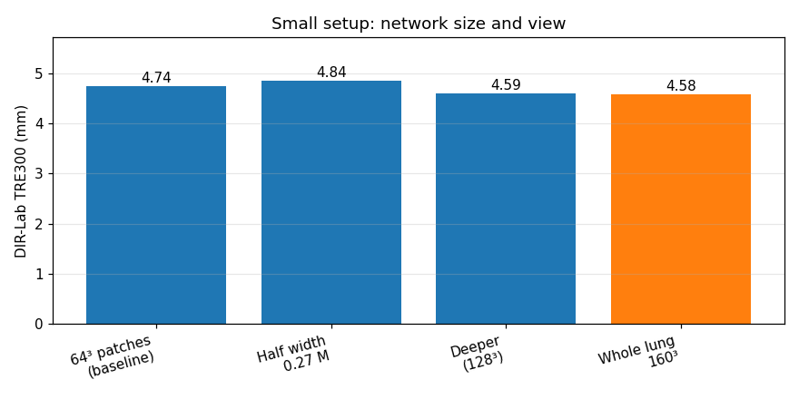

---

## Slide 5b · Two training setups: "big" and "small"

Same network (UNetCRBDecoder, 1.07 M parameters) and base loss, different training.

| | **Big model (TCIA3.5)** | **Small model (TCIA-lite)** |
|---|---|---|
| Patients / scans | 20 / **82** | 16 / **65** (4 patients held out) |
| What it sees in training | **64³ patches** (16 per pair) | **whole lung 160³** (1 per pair) |
| Training | 100 epochs, constant learning rate | 40 epochs, learning rate lowered (cosine) |
| Augmentation | none | flip, shift, zoom, brightness, noise |
| Time per run | about 35 h | about 11 h |
| DIR-Lab (best) | **4.07** (old loss + flip, 2 seeds) | about 4.1–4.2 |

- Big model: more patients, best overall and on POPI. Small model: better on the deepest breather (C8) and stable across seeds (4.17 vs 4.16).
- They make **different mistakes**, so combining them helps (3.95 mm).

| Big model (64³ patches, old loss) | Small model (whole lung, hybrid) |
|---|---|
| 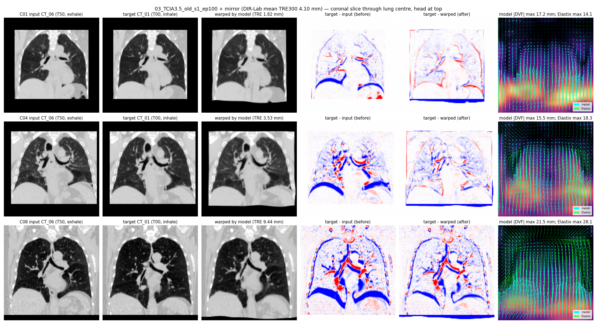 | 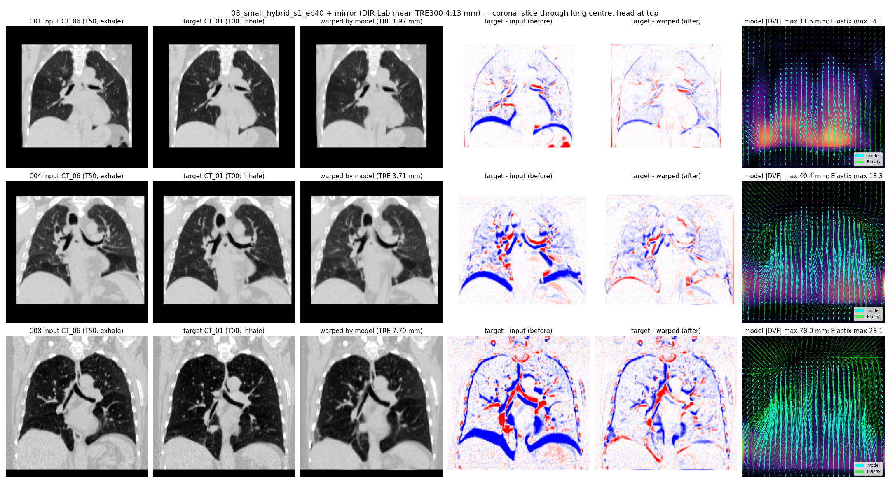 |

---

## Slide 5c · Bigger or smaller network?

| Network (small setup, 30 Sep) | Change | DIR-Lab |
|---|---|---|
| Baseline, 64³ patches | — | 4.74 |
| Half width (0.27 M) | smaller | 4.84 (worse) |
| One extra level (128³) | deeper | 4.59 |
| Whole lung 160³ (same 1.07 M) | sees more lung | **4.58** |

- **1.07 M is the right size.** Smaller learns less; deeper only helped because it saw more lung.
- Not underfitting: training error reached the label-noise floor. **What the model sees matters more than its size.**

**Case by case (early models):**

| Model | C1 | C2 | C3 | C4 | C5 | C6 | C7 | C8 | C9 | C10 | **Mean** | C1–5 | C6–10 |
|---|---|---|---|---|---|---|---|---|---|---|---|---|---|
| No motion | 3.89 | 4.34 | 6.94 | 9.83 | 7.48 | 10.89 | 11.03 | 14.99 | 7.92 | 7.30 | **8.46** | 6.50 | 10.43 |
| TCIA3 (fixed scorer) | 2.83 | 2.05 | 3.04 | 3.71 | 3.79 | 4.51 | 6.17 | 9.15 | 3.54 | 3.67 | **4.25** | 3.08 | 5.41 |
| Lite 64³ patches | 2.89 | 2.18 | 3.44 | 4.72 | 4.34 | 4.71 | 6.77 | 9.22 | 5.16 | 3.94 | **4.74** | 3.51 | 5.96 |
| Lite half width | 2.20 | 2.01 | 3.37 | 5.24 | 4.72 | 5.20 | 7.30 | 9.91 | 4.71 | 3.77 | **4.84** | 3.51 | 6.18 |
| Lite deeper 128³ | 2.49 | 1.91 | 2.87 | 5.43 | 5.01 | 4.20 | 6.31 | 9.71 | 4.49 | 3.49 | **4.59** | 3.54 | 5.64 |
| Lite whole lung 160³ | 2.98 | 2.49 | 2.88 | 4.33 | 5.08 | 4.88 | 6.83 | 8.68 | 3.99 | 3.62 | **4.58** | 3.55 | 5.60 |

---

## Slide 5d · The four small-setup networks, in detail

All four use the **same U-Net (UNetCRBDecoder)**: a plain encoder that sees only the CT, and a decoder whose blocks are told the two breathing phases (conditional residual blocks); the output is the 3-channel motion field. Same data (65 scans / 16 patients, validation 17 scans / 4 new patients), loss (lung-masked L1), Adam lr 1e-4 constant, no augmentation, seed 20260929.

| | A′ (baseline) | A′-small | A′-deep128 | A′-full160 |
|---|---|---|---|---|
| What changed | — | every channel halved | +1 level down/up, and 128³ crops | whole 160³ volume |
| Levels (image halvings) | 5 (4 halvings) | 5 (4) | **6 (5)** | 5 (4) |
| Channels, top → bottom | 16-32-32-64-64 | **8-16-16-32-32** | 16-32-32-64-64-**128** | 16-32-32-64-64 |
| Parameters | 1.07 M | **0.27 M** | **2.20 M** | 1.07 M |
| Training view | 64³ crops, 4 per pair | 64³ crops, 4 per pair | **128³ crop, 1 per pair** | **whole 160³, 1 per pair** |
| Smallest map inside the net | 4³ | 4³ | 4³ | 10³ |
| Epochs | 80 | 80 | 80 | 40 |
| Training time | 6 h 20 min | 4 h 37 min | 13 h 37 min | 10 h 24 min |
| GPU memory | — | 0.2 GB | 2.4 GB | 4.7 GB |
| Final train / val error | 0.262 / 0.494 | 0.317 / 0.488 | 0.214 / 0.529 | 0.239 / 0.566 |
| **DIR-Lab TRE300** (last 5 epochs) | 4.74 | 4.84 (worse) | 4.59 | **4.58** |

- **Why deep128 needed 128³ crops:** each level halves the image. A 64³ crop after 5 halvings is only 2³, almost nothing to look at; 128³ keeps it at 4³, like the baseline.
- **Why full160 kept the baseline net:** to separate "sees more" from "is deeper". It matched deep128 without the extra level and was better on C08 (8.68 vs 9.71), so the whole-lung view was kept.
- **Reading the curves:** training error keeps falling while validation error is flat from about epoch 5 (A′ 0.48–0.51), so most later training is memorising. The small net memorises less (smaller gap) but does not score better on DIR-Lab. Validation numbers are measured on different views (64³ crops / one 128³ crop / whole volume), so compare their shapes, not their levels.

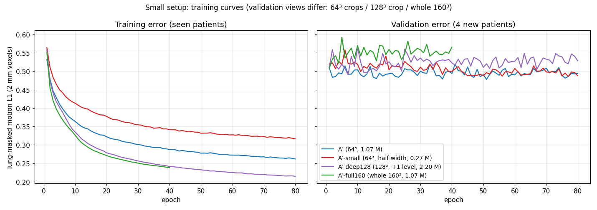

| A′ | A′-small |
|---|---|
| 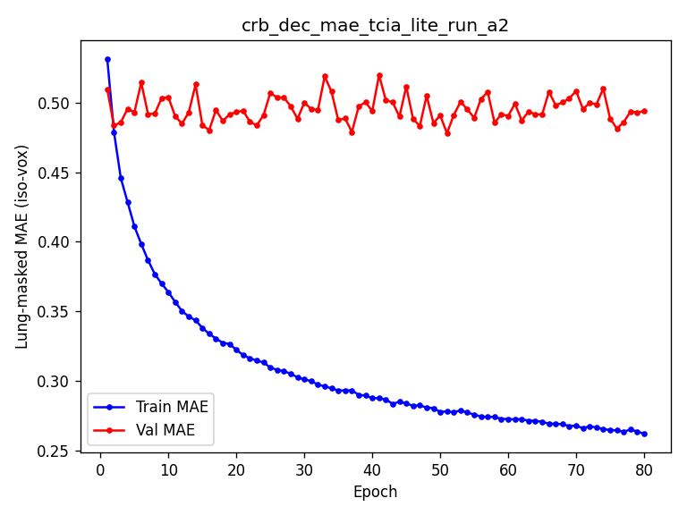 | 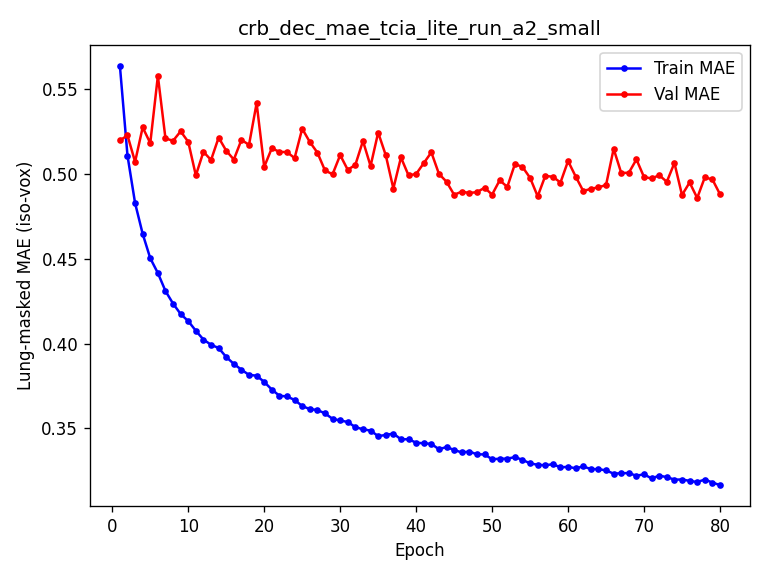 |
| **A′-deep128** | **A′-full160** |
| 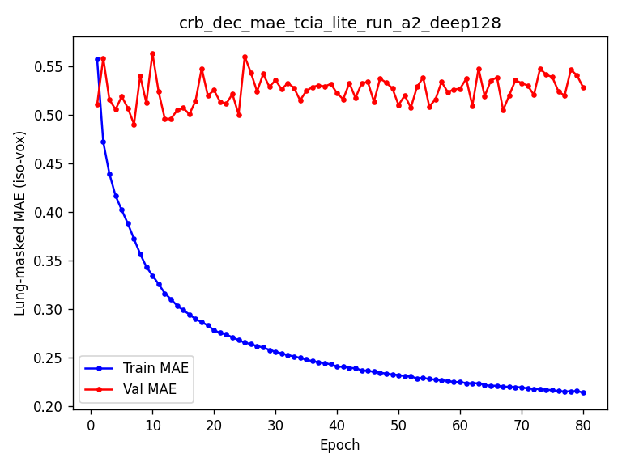 | 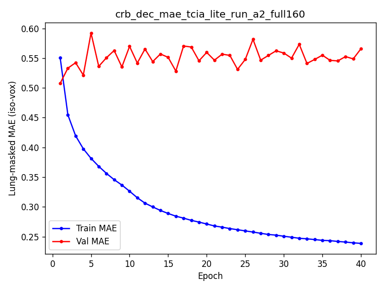 |

---

## Slide T · The timeline in pictures: how to read them

Each picture uses the **same layout as slide 5b**: rows **C01** (shallow breather, 3.9 mm average motion), **C04** (middle) and **C08** (deep breather, 15.0 mm), on the mid-coronal slice of the fixed 2 mm grid, head at top. Columns, left to right:

1. **Input T50** (breathed-out CT).
2. **Target T00** (breathed-in CT).
3. **T50 warped by the model** toward T00, with that model's TRE75 and TRE300 for the case (mean ± SD over the 75 / 300 landmarks). Column 1 gives the same numbers with no motion.
4. **Target − input (before)**: red/blue = what has to move.
5. **Target − warped (after)**: the closer to white, the better the match (lung NCC is in the table below).
6. **Model motion |u|** with arrows: **cyan = model, green = Elastix** (the label).

Steps that compare two models show two pictures, one per model. Numbers are for **that one checkpoint**, so they differ from the headline numbers (last-5-epoch and 2-seed means). The band at the bottom edge of the box is the end of the scan, not a model error.

This first picture is **Elastix itself**: the best a model could do by copying its label.

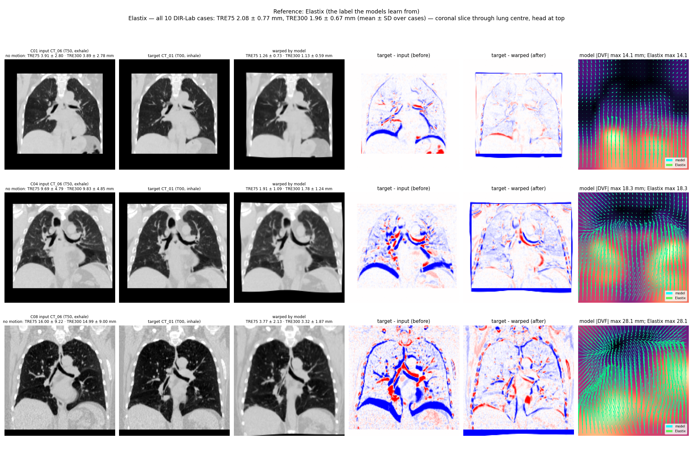

| | C01 Elastix | C04 Elastix | C08 Elastix |
|---|---|---|---|
| TRE75 (mm, mean ± SD) | 1.26 ± 0.73 | 1.91 ± 1.09 | 3.77 ± 2.13 |
| TRE300 (mm, mean ± SD) | 1.13 ± 0.59 | 1.78 ± 1.24 | 3.32 ± 1.87 |
| Lung NCC | 0.972 | 0.941 | 0.875 |

**All 10 DIR-Lab cases** (mean ± SD over cases):

| | TRE75 (mm) | TRE300 (mm) |
|---|---|---|
| Elastix | 2.08 ± 0.77 | 1.96 ± 0.67 |

---

## Slide T1 · 30 Sep · Whole-lung view (A′-full160)

- The small setup, no augmentation, whole 160³ volume.
- C01: motion at the lung base, but **uneven** (strong on one side, weak on the other). C08: **far too small** compared with Elastix (colour scale up to 25 mm).

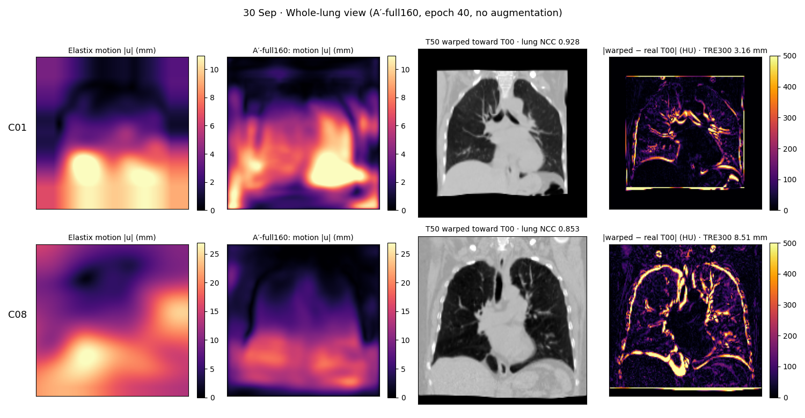

| | C01 A′-full160 | C04 A′-full160 | C08 A′-full160 |
|---|---|---|---|
| TRE75 (mm, mean ± SD) | 3.25 ± 1.80 | 4.06 ± 2.50 | 9.14 ± 5.93 |
| TRE300 (mm, mean ± SD) | 3.16 ± 1.80 | 4.14 ± 2.43 | 8.51 ± 5.77 |
| Lung NCC | 0.928 | 0.923 | 0.853 |

**All 10 DIR-Lab cases** (mean ± SD over cases):

| | TRE75 (mm) | TRE300 (mm) |
|---|---|---|
| A′-full160 | 4.65 ± 1.85 | 4.52 ± 1.74 |

**Training curves** (motion L1 only, also for hybrid runs). Small model: validation = 4 held-out TCIA patients, whole lung. Big model: validation = 820 of the 8200 pairs from the *same* 82 scans (no held-out patients), on 64³ crops, so its validation is close to training error. Compare curves only within one model type:

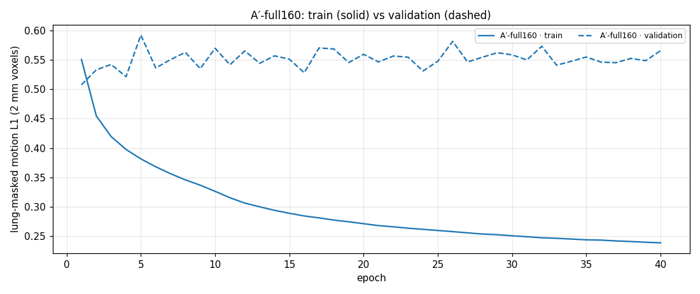

---

## Slide T2 · 1 Oct · + augmentation and cosine learning rate (TCIA-lite)

- Pictures show the **plain** prediction (no mirror); mirror results for the small models are on slide T3.
- Flip, shift, zoom, brightness and noise; cosine learning rate. This became the **small model**.
- C01 improves clearly (less overshoot); C08 is still much too small: breath depth again.

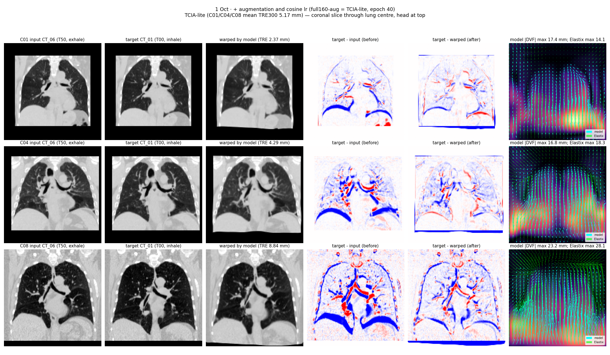

| | C01 TCIA-lite | C04 TCIA-lite | C08 TCIA-lite |
|---|---|---|---|
| TRE75 (mm, mean ± SD) | 2.48 ± 1.28 | 4.28 ± 2.30 | 9.56 ± 6.40 |
| TRE300 (mm, mean ± SD) | 2.37 ± 1.32 | 4.29 ± 2.44 | 8.84 ± 6.24 |
| Lung NCC | 0.956 | 0.927 | 0.869 |

**All 10 DIR-Lab cases** (mean ± SD over cases):

| | TRE75 (mm) | TRE300 (mm) |
|---|---|---|
| TCIA-lite | 4.56 ± 1.91 | 4.47 ± 1.76 |

**Training curves** (motion L1 only, also for hybrid runs). Small model: validation = 4 held-out TCIA patients, whole lung. Big model: validation = 820 of the 8200 pairs from the *same* 82 scans (no held-out patients), on 64³ crops, so its validation is close to training error. Compare curves only within one model type:

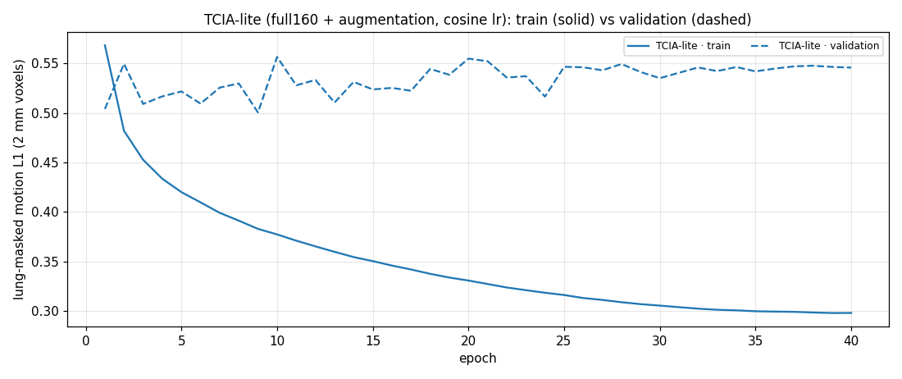

---

## Slide T3 · 1 Oct · Mirror (flip) averaging on the big model

- Average each prediction with the prediction on the left-right mirrored CT (left-right motion sign flipped back).
- Free (no training). Helps both cases a little here; −0.18 mm on all 10 cases for the big model.
- The big model's motion is sharper and more patchy than the small model's (it was trained on 64³ patches).
- Idea: standard test-time augmentation, as in nnU-Net (Isensee et al. 2018, arXiv:1809.10486), which mirrors at inference but does not measure the gain. For motion, the left-right component must also be negated when flipping back. The gain below is our own measurement.
- Mirror also tested on the small (TCIA-lite) models: it helps, but less, because they were trained with left-right flips and already give nearly the same answer on the mirrored CT.

| Model (DIR-Lab TRE300, all 10 cases) | Plain | Mirror | Change |
|---|---|---|---|
| TCIA-lite (full160-aug, epochs 36–40) | 4.47 | 4.40 | −0.07 |
| Small hybrid (2-seed mean, epochs 36–40) | 4.17 | 4.06 | −0.10 |
| **Big model TCIA3.5 (epochs 96–100)** | 4.20 | 4.02 | **−0.18** |

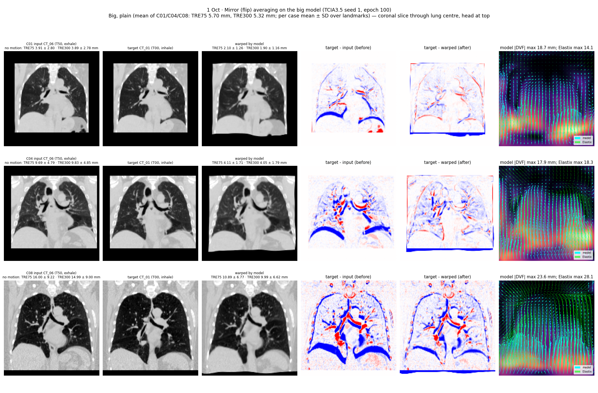

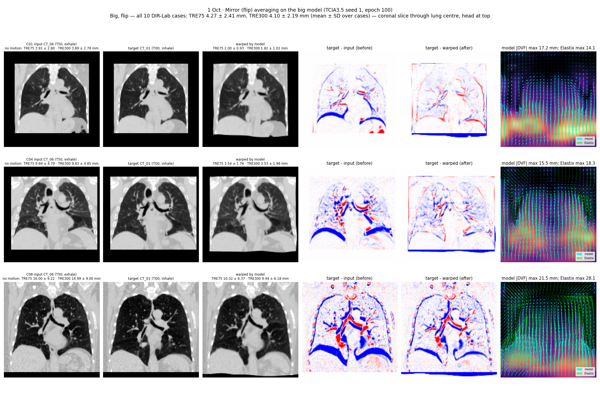

| | C01 Big, plain | C01 Big, flip | C04 Big, plain | C04 Big, flip | C08 Big, plain | C08 Big, flip |
|---|---|---|---|---|---|---|
| TRE75 (mm, mean ± SD) | 2.10 ± 1.26 | 2.00 ± 0.93 | 4.11 ± 1.72 | 3.54 ± 1.76 | 10.89 ± 6.77 | 10.32 ± 6.37 |
| TRE300 (mm, mean ± SD) | 1.90 ± 1.16 | 1.82 ± 1.01 | 4.05 ± 1.79 | 3.53 ± 1.98 | 9.99 ± 6.62 | 9.44 ± 6.18 |
| Lung NCC | 0.970 | 0.969 | 0.933 | 0.939 | 0.851 | 0.853 |

**All 10 DIR-Lab cases** (mean ± SD over cases):

| | TRE75 (mm) | TRE300 (mm) |
|---|---|---|
| Big, plain | 4.48 ± 2.48 | 4.28 ± 2.26 |
| Big, flip | 4.27 ± 2.41 | 4.10 ± 2.19 |

**Training curves** (motion L1 only, also for hybrid runs). Small model: validation = 4 held-out TCIA patients, whole lung. Big model: validation = 820 of the 8200 pairs from the *same* 82 scans (no held-out patients), on 64³ crops, so its validation is close to training error. Compare curves only within one model type:

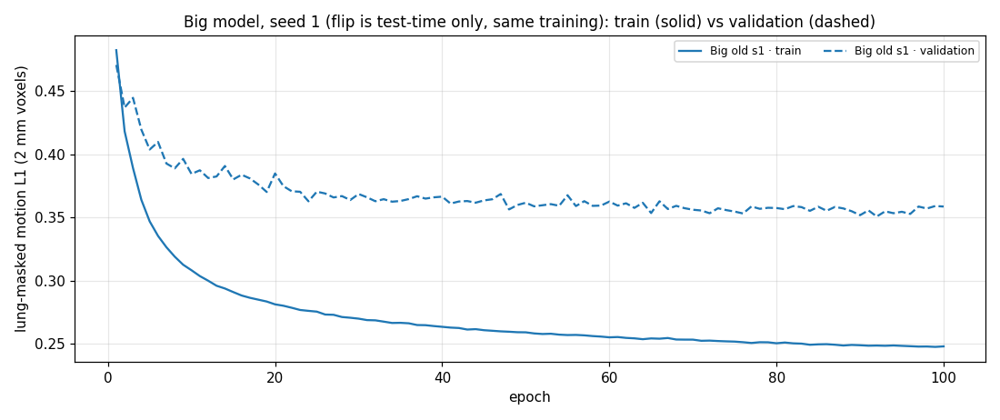

---

## Slide T4 · 2 Oct · Hybrid loss on the small model

- Pictures show the **plain** prediction (no mirror); mirror results for the small models are on slide T3.
- Motion + 10 × image match + 0.1 × smoothness. The image term pulls the warped CT toward the real T00.
- **Balancing factors (why 10 and 0.1):** the parts are in different units, so they are weighted to have about equal influence.
  - Motion error ≈ **0.25** (2 mm voxels; old-loss training settles at 0.248). Image error ≈ **0.02** (CT brightness scaled 0–1; logged 0.019–0.023).
  - 0.25 / 0.02 ≈ 12 → **× 10** brings the image term to ≈ 0.2, level with motion. Without it the image term would be ~10× too small to matter.
  - Smoothness × **0.1**: a light touch, only to stop jagged motion (first-order, see slide 9).
  - Fixed **before** training, never tuned on DIR-Lab. Checked later: × 30 was worse (4.34 vs 4.17 mm), so 10 stayed. Details on slide 8.
- **Where 0.25 comes from, and what it is not:**
  - It is the **training motion error** read from the big old-loss model's log: mean of epochs 90–100 = **0.248**. Units are **voxels** (2 mm each), so ≈ **0.5 mm** per direction. For scale: no motion = 0.685, label-noise floor ≈ 0.165.
  - It is **not** the model's accuracy. It is (1) on training patients (new patients ≈ 0.55 vox ≈ 1.1 mm), (2) against Elastix, which is itself ≈ 2 mm off at landmarks, (3) averaged over all lung voxels, most of which barely move, and (4) per direction, not 3D distance.
  - The real accuracy is the **TRE**: ≈ **4 mm** on new patients (DIR-Lab), 8–9 mm on the deep breather C08. 0.25 is only used to balance the loss.
- Both cases improve; the error images get darker around the diaphragm.

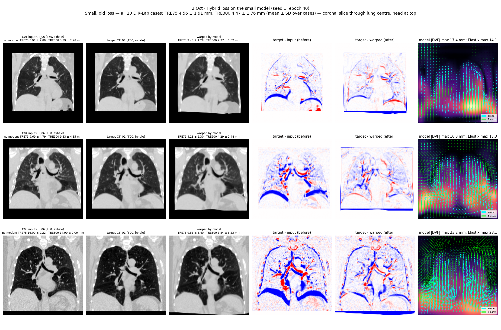

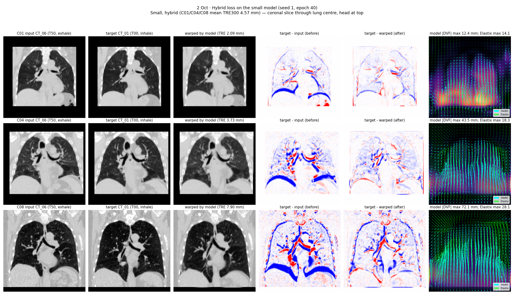

| | C01 Small, old loss | C01 Small, hybrid | C04 Small, old loss | C04 Small, hybrid | C08 Small, old loss | C08 Small, hybrid |
|---|---|---|---|---|---|---|
| TRE75 (mm, mean ± SD) | 2.48 ± 1.28 | 2.34 ± 1.54 | 4.28 ± 2.30 | 3.61 ± 1.96 | 9.56 ± 6.40 | 8.46 ± 5.90 |
| TRE300 (mm, mean ± SD) | 2.37 ± 1.32 | 2.09 ± 1.41 | 4.29 ± 2.44 | 3.73 ± 2.15 | 8.84 ± 6.24 | 7.90 ± 5.59 |
| Lung NCC | 0.956 | 0.962 | 0.927 | 0.918 | 0.869 | 0.874 |

**All 10 DIR-Lab cases** (mean ± SD over cases):

| | TRE75 (mm) | TRE300 (mm) |
|---|---|---|
| Small, old loss | 4.56 ± 1.91 | 4.47 ± 1.76 |
| Small, hybrid | 4.29 ± 1.79 | 4.17 ± 1.72 |

**Training curves** (motion L1 only, also for hybrid runs). Small model: validation = 4 held-out TCIA patients, whole lung. Big model: validation = 820 of the 8200 pairs from the *same* 82 scans (no held-out patients), on 64³ crops, so its validation is close to training error. Compare curves only within one model type:

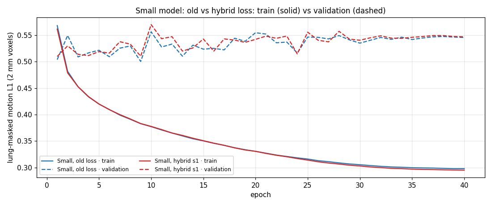

---

## Slide T5 · 2–4 Oct · Hybrid loss on the big model (seed 1)

- Looked like the best model (3.87 mm on all 10 cases, with flip).
- In pictures: **better on C08** (the warped CT matches better, error image darker), **worse on C01**.

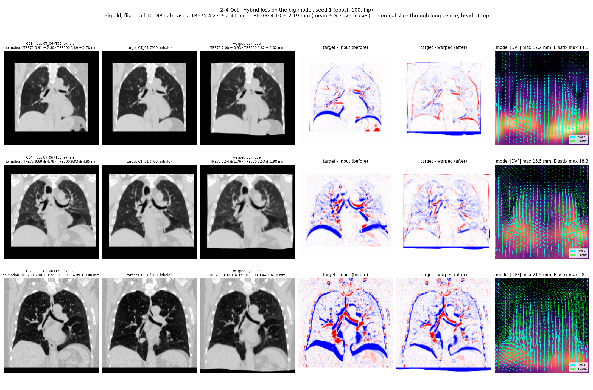

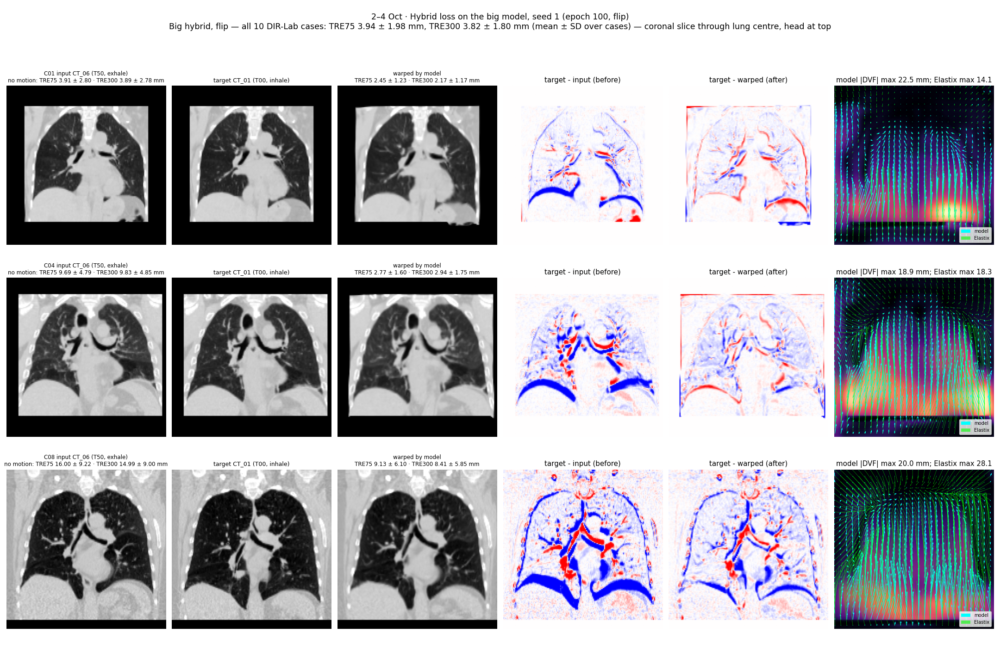

| | C01 Big old, flip | C01 Big hybrid, flip | C04 Big old, flip | C04 Big hybrid, flip | C08 Big old, flip | C08 Big hybrid, flip |
|---|---|---|---|---|---|---|
| TRE75 (mm, mean ± SD) | 2.00 ± 0.93 | 2.45 ± 1.23 | 3.54 ± 1.76 | 2.77 ± 1.60 | 10.32 ± 6.37 | 9.13 ± 6.09 |
| TRE300 (mm, mean ± SD) | 1.82 ± 1.01 | 2.17 ± 1.17 | 3.53 ± 1.98 | 2.94 ± 1.75 | 9.44 ± 6.18 | 8.41 ± 5.86 |
| Lung NCC | 0.969 | 0.953 | 0.939 | 0.941 | 0.853 | 0.870 |

**All 10 DIR-Lab cases** (mean ± SD over cases):

| | TRE75 (mm) | TRE300 (mm) |
|---|---|---|
| Big old, flip | 4.27 ± 2.41 | 4.10 ± 2.19 |
| Big hybrid, flip | 3.94 ± 1.98 | 3.82 ± 1.80 |

**Training curves** (motion L1 only, also for hybrid runs). Small model: validation = 4 held-out TCIA patients, whole lung. Big model: validation = 820 of the 8200 pairs from the *same* 82 scans (no held-out patients), on 64³ crops, so its validation is close to training error. Compare curves only within one model type:

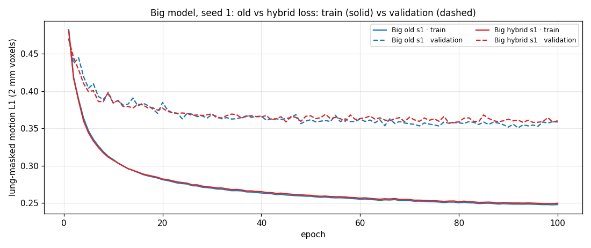

---

## Slide T6 · 4–6 Oct · Second seed: the gain does not repeat

- Same two recipes, new random start. Now the hybrid is **worse** on C08 and slightly better on C01: the opposite of seed 1.
- So the seed-1 difference was luck. Over 16 patients the hybrid gain is +0.02 mm (p = 0.46).

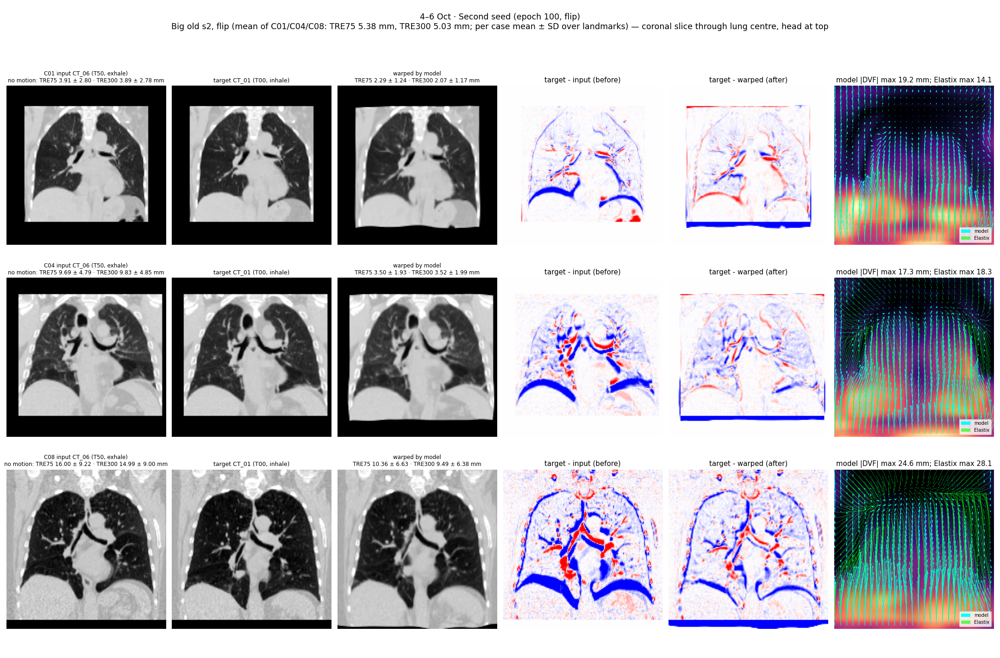

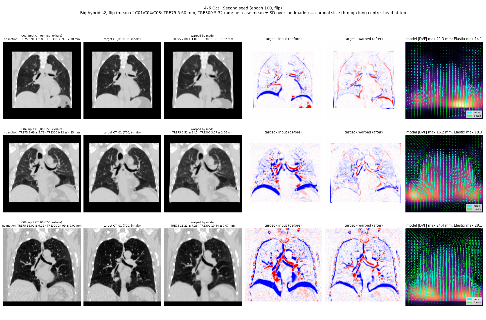

| | C01 Big old s2, flip | C01 Big hybrid s2, flip | C04 Big old s2, flip | C04 Big hybrid s2, flip | C08 Big old s2, flip | C08 Big hybrid s2, flip |
|---|---|---|---|---|---|---|
| TRE75 (mm, mean ± SD) | 2.29 ± 1.24 | 2.08 ± 1.00 | 3.50 ± 1.93 | 3.51 ± 2.15 | 10.36 ± 6.63 | 11.21 ± 7.26 |
| TRE300 (mm, mean ± SD) | 2.07 ± 1.17 | 1.96 ± 1.02 | 3.52 ± 1.99 | 3.57 ± 2.35 | 9.49 ± 6.38 | 10.44 ± 7.07 |
| Lung NCC | 0.964 | 0.961 | 0.943 | 0.940 | 0.861 | 0.856 |

**All 10 DIR-Lab cases** (mean ± SD over cases):

| | TRE75 (mm) | TRE300 (mm) |
|---|---|---|
| Big old s2, flip | 4.35 ± 2.41 | 4.17 ± 2.21 |
| Big hybrid s2, flip | 4.45 ± 2.64 | 4.33 ± 2.46 |

**Training curves** (motion L1 only, also for hybrid runs). Small model: validation = 4 held-out TCIA patients, whole lung. Big model: validation = 820 of the 8200 pairs from the *same* 82 scans (no held-out patients), on 64³ crops, so its validation is close to training error. Compare curves only within one model type:

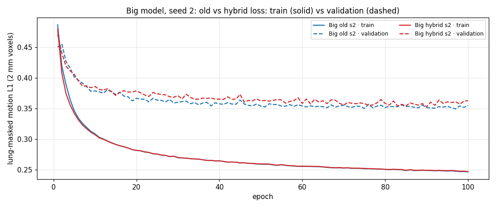

---

## Slide T7 · 8 Oct · Pre-set combination (2 small hybrid + 2 big old, flip)

- Average the four motion fields. The small and big models make **different mistakes**, so they partly cancel.
- Best C01 of all models and good lung match on both; C08 is still limited by breath depth.
- All 10 cases: **3.95 mm DIR-Lab, 4.53 mm POPI**.

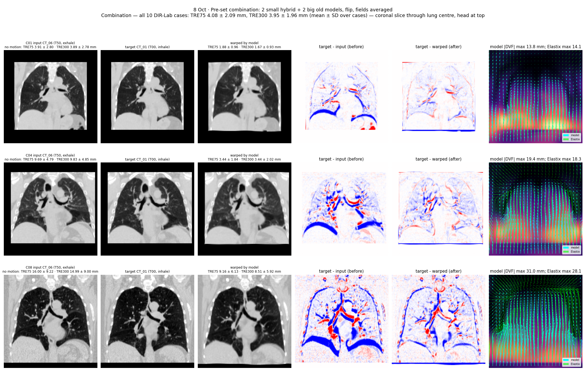

| | C01 Combination | C04 Combination | C08 Combination |
|---|---|---|---|
| TRE75 (mm, mean ± SD) | 1.88 ± 0.96 | 3.44 ± 1.84 | 9.16 ± 6.13 |
| TRE300 (mm, mean ± SD) | 1.67 ± 0.93 | 3.44 ± 2.02 | 8.51 ± 5.92 |
| Lung NCC | 0.976 | 0.940 | 0.873 |

**All 10 DIR-Lab cases** (mean ± SD over cases):

| | TRE75 (mm) | TRE300 (mm) |
|---|---|---|
| Combination | 4.08 ± 2.08 | 3.94 ± 1.96 |

**Training curves** (motion L1 only, also for hybrid runs). Small model: validation = 4 held-out TCIA patients, whole lung. Big model: validation = 820 of the 8200 pairs from the *same* 82 scans (no held-out patients), on 64³ crops, so its validation is close to training error. Compare curves only within one model type:

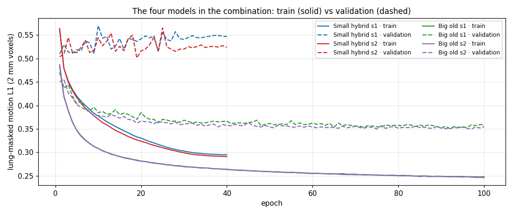

---

## Slide 6 · Ideas that did not work

- Push-style labels, re-made labels, brightness matching, EPE loss, combining old models: each **less than 0.1 mm**.
- Conclusion: the model learns **Elastix very well, including Elastix's mistakes** (training error at the label-noise floor).

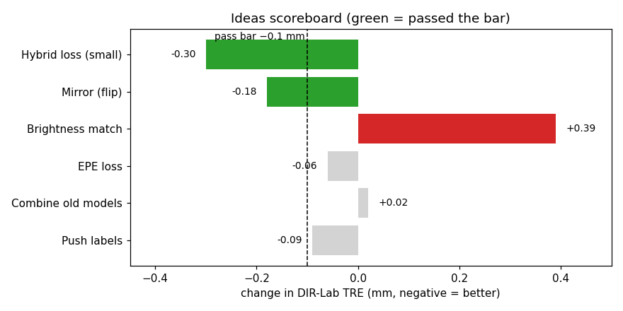

---

## Slide 7 · Why the hybrid loss

- **Problem:** the model only copies Elastix, so it copies Elastix's errors.
- **Idea from the literature** (RMSim; noisy-label work): also check **whether the images actually line up**.
- **Hybrid loss = motion error + image match + smoothness.** The image signal does not share Elastix's mistakes.

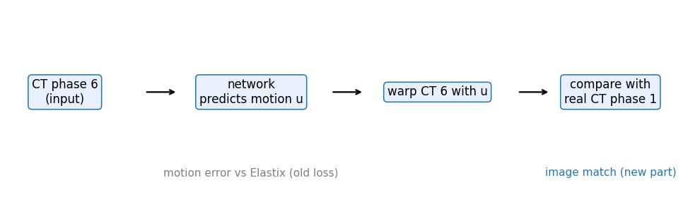

---

## Slide 8 · How the weights were chosen (an educated guess)

- **Loss = motion + 10 × image + 0.1 × smoothness.**
- Rule of thumb: make each part about the same size (image ≈ 0.02 × 10 ≈ 0.2, close to motion ≈ 0.25; smoothness a light touch).
- **Why 10: the parts are in different units**, so they need balancing (not a correction of any error):

| Loss part | What it measures | Units | Typical size during training |
|---|---|---|---|
| Motion error (L1) | predicted motion vs Elastix | voxels (2 mm each) | about 0.25 |
| Image error (L1) | warped CT vs real CT | image brightness, scaled 0–1 | about 0.02 |

**Where these two numbers come from (measured, not assumed):**

- **Motion error ≈ 0.25** = the training motion error the old-loss main model (TCIA3.5) settles at: mean over epochs 90–100 = **0.248**.
  - Definition (`DVFLoss`): inside the lung mask, the mean of |Elastix label − prediction| over all voxels and the 3 components, in 2 mm voxels. So 0.25 ≈ 0.5 mm per component.
  - For scale: predicting no motion gives 0.685; the measured label-noise floor is about 0.165.
- **Image error ≈ 0.02** = the image term's size in practice: mean |real CT − warped CT| in the lung mask (dilated 2 voxels), on CT brightness min-max scaled to 0–1.
  - Logged values: 0.019–0.023 during small-model hybrid training; 0.027 with the Elastix labels on 64³ patches (big-model safety check).
- So 0.25 / 0.02 ≈ 12, rounded to **10**.

- The image error is naturally about 10× smaller; added as is it would be almost invisible to training. × 10 brings it to about 0.2, so **both parts have about equal influence**.
- **Fixed before training, never tuned on DIR-Lab** (tuning on the test set would inflate the result).
- Checked later: **weight 30 was worse** (4.34 vs 4.17), so 10 stayed.

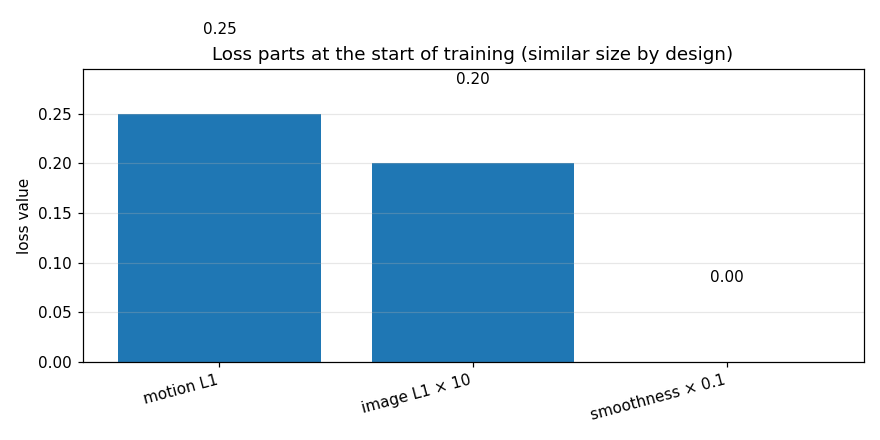

---

## Slide 9 · Why first-order smoothness, not second-order

| | **First-order** (used) | **Second-order (bending energy)** |
|---|---|---|
| Name | **diffusion penalty** (squared gradient, as in VoxelMorph) | bending energy |
| Penalises | sudden changes between neighbours | bending / curving of the motion |
| Even stretch (lung expanding) | penalised a little | free |
| Typical in | deep-learning registration (VoxelMorph) | B-spline registration (Elastix) |

- Our term: mean of squared differences between neighbouring motion vectors along z, y, x (forward differences), over the **whole volume**, weight 0.1.
- Chosen as a **simple, standard, stable default** with a **light weight (0.1)**, only to stop jagged motion.
- **Not tested:** second-order might suit breathing (smooth stretching) slightly better; expected effect small.

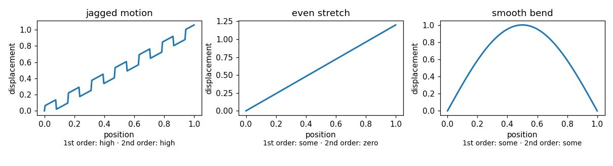

---

---

## Slide 10 · Hybrid loss on the small model: it works, twice

- Small model (whole lung): **4.47 → 4.17 mm** (seed 1) and **4.16 mm** (seed 2), 7/10 and 9/10 cases better.
- First change in the project to pass the fixed rule (> 0.1 mm better, ≥ 7/10 cases).
- But on POPI the small hybrid was **not** better (4.80 / 5.05 vs 4.73 old loss).

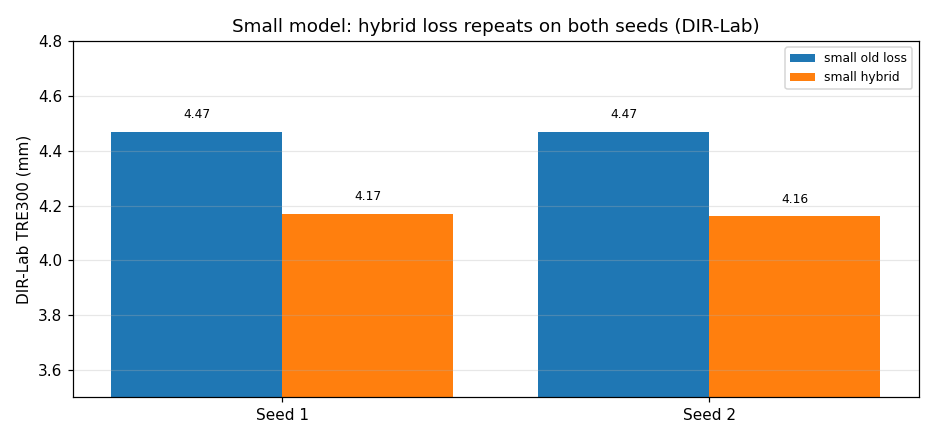

---

## Slide 11 · Hybrid loss on the big model: one lucky seed

- Seed 1 looked great: **3.87 mm** with flip. Seed 2: **4.37 mm**.
- Averaged over seeds: hybrid 4.12 vs old loss **4.07**, no improvement (16-patient test +0.02 mm, p = 0.46).
- Big-model hybrid seeds differ by **0.5 mm**; old loss only 0.1 mm. Likely causes: 64³ patches (image check sees little lung, padded edges) and a constant learning rate.
- **Lesson:** always run a second seed before claiming a gain.

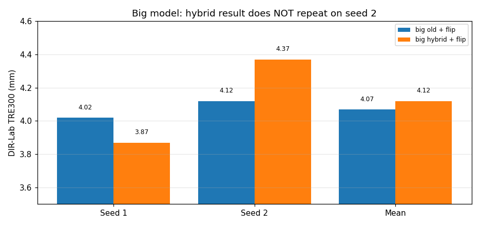

---

## Slide 12 · Making the result stable

- Averaging the last 10 epochs' weights: helps the old loss a little (−0.08 mm), does not fix the hybrid seed gap.
- **Combining 2 small + 2 big models** (fixed before scoring): **3.95 mm DIR-Lab, 4.53 mm POPI**. Small and big models make different mistakes.

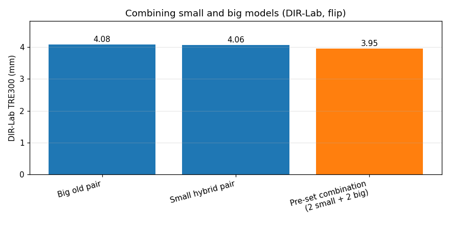

---

## Slide 13 · Local NCC: promising on paper, tiny in practice

- Check 1: local NCC notices motion errors much better than plain image difference (rank correlation 0.84–0.89 vs 0.50–0.65), but is noisy.
- Check 2: moving toward the true landmark motion lowers local NCC by **40%** vs 8.5% for plain difference.
- Check 3 (5-epoch top-up vs matched control): **−0.02 mm DIR-Lab, 0.00 POPI**. Not kept.

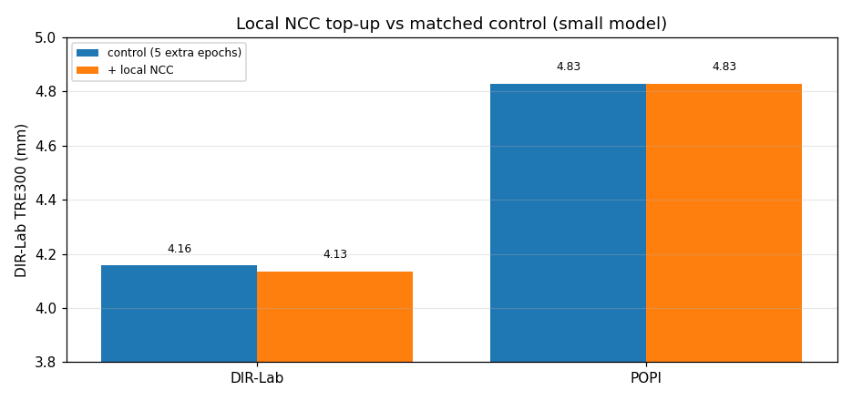

---

## Slide 14 · Label quality matters

- Adding the 4 held-out patients (82 scans) made the small model **worse** (4.16 → 4.50).
- Their Elastix labels are noisier (forward-backward error +17%); one scan (S29) is clearly bad (folding +4.2 SD).
- **Removing 4 flagged scans** (78 scans): 4.27 DIR-Lab and the **best small-model POPI (4.73)**.

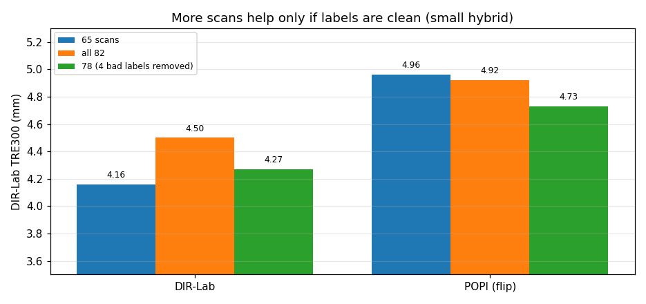

---

## Slide 15 · X-ray models (VoxelMap): better data helps, but not enough

- **A2:** VoxelMap trained on 9 SPARE patients, tested zero-shot: **7.12 mm** (weights found and re-verified).
- **A2-TCIA:** same network and settings, trained on 82 TCIA scans: **5.14 mm**.
- Still worse than the single-CT model (**4.07**) on every case, most on the big scans (C6–10: 7.13 vs 5.52).
- Likely reason: this variant only sees the two X-rays, **never the CT**, so it cannot use anatomy or scan size.

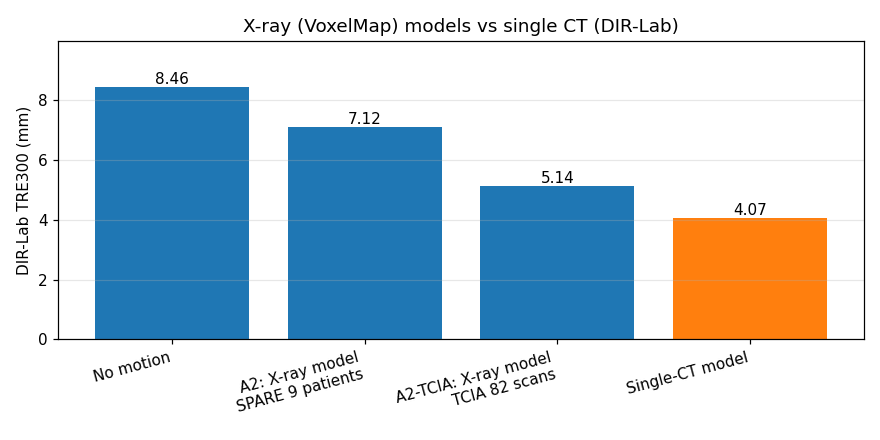

---

## Slide 16 · Two CTs and the literature

- With **two CTs**, scaled Elastix (no training) gives **2.0 mm** (2.35 on C6–10), beating the published physics model (Fuerst et al., 3.88).
- So knowing breath depth takes the error from about 4–5 mm to about 2 mm: **missing depth is the main cost of one CT**.
- Literature: no method found that predicts from **one CT without a breathing signal** and reports DIR-Lab/POPI landmark error. Closest: Kanamuro et al. 2025 (one CT, private data, no landmarks).

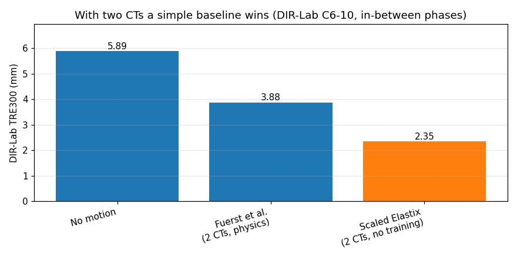

---

## Slide 17 · Summary

- **Best single model:** 4.07 mm DIR-Lab, 4.57 mm POPI (2 seeds). **Pre-set combination:** 3.95 / 4.53 mm.
- About **half of the motion error removed** from one CT, in the range of methods that need a breathing signal (3.3–4.2 mm).
- What helped: fixing the scorer, flip averaging, combining models, clean labels. Loss changes: no reliable gain.
- **Limit: breath depth is invisible in one CT.** Deep breathers (C8) carry most of the error.

## Appendix A · Small model, case by case (epochs 36–40)

| Model | C1 | C2 | C3 | C4 | C5 | C6 | C7 | C8 | C9 | C10 | **Mean** | C1–5 | C6–10 |
|---|---|---|---|---|---|---|---|---|---|---|---|---|---|
| Small, old loss (65 scans) | 2.37 | 3.03 | 3.14 | 4.26 | 4.48 | 4.06 | 6.23 | 8.83 | 4.38 | 3.93 | **4.47** | 3.45 | 5.49 |
| Small, hybrid seed 1 | 2.09 | 2.43 | 2.84 | 3.73 | 3.90 | 4.19 | 6.66 | 7.90 | 3.97 | 4.00 | **4.17** | 3.00 | 5.34 |
| Small, hybrid seed 2 | 2.02 | 2.39 | 3.06 | 3.91 | 4.48 | 4.19 | 6.17 | 7.61 | 3.91 | 3.90 | **4.16** | 3.17 | 5.15 |
| Small, hybrid all 82 scans | 2.09 | 2.23 | 2.85 | 4.03 | 4.46 | 5.48 | 6.61 | 9.07 | 4.23 | 3.90 | **4.50** | 3.13 | 5.86 |
| Small, hybrid 78 clean scans | 1.95 | 2.51 | 3.17 | 3.14 | 4.22 | 4.54 | 6.23 | 9.03 | 4.23 | 3.63 | **4.27** | 3.00 | 5.53 |
| Small, old loss all 82 | 2.44 | 2.18 | 2.81 | 3.62 | 3.80 | 4.97 | 7.21 | 8.91 | 3.97 | 3.96 | **4.39** | 2.97 | 5.80 |

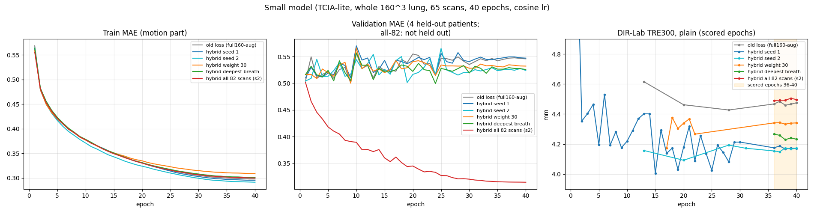

## Appendix B · Big model and final results, case by case (epochs 96–100, 2-seed mean)

| Model | C1 | C2 | C3 | C4 | C5 | C6 | C7 | C8 | C9 | C10 | **Mean** | C1–5 | C6–10 |
|---|---|---|---|---|---|---|---|---|---|---|---|---|---|
| Big, old loss | 2.19 | 1.91 | 2.57 | 3.77 | 4.03 | 4.72 | 5.88 | 9.57 | 4.07 | 3.44 | **4.21** | 2.89 | 5.53 |
| Big, hybrid loss | 2.26 | 2.16 | 2.72 | 3.48 | 4.20 | 4.99 | 6.05 | 9.66 | 3.86 | 3.51 | **4.29** | 2.96 | 5.62 |
| **Big, old loss + flip (best single)** | 1.97 | 1.87 | 2.44 | 3.38 | 3.46 | 4.97 | 6.01 | 9.33 | 3.93 | 3.34 | **4.07** | 2.62 | 5.52 |
| Big, hybrid + flip | 2.03 | 2.01 | 2.50 | 3.35 | 3.49 | 5.07 | 6.10 | 9.30 | 3.72 | 3.63 | **4.12** | 2.68 | 5.56 |
| Pre-set combination (2 small + 2 big, flip) | 1.67 | 1.85 | 2.45 | 3.44 | 3.66 | 4.51 | 6.17 | 8.51 | 3.83 | 3.37 | **3.95** | 2.61 | 5.28 |

POPI (6 patients, 2-seed mean): old loss + flip **4.57** mm; hybrid + flip 4.54 mm.

## Appendix C · X-ray (VoxelMap) models vs single CT, case by case

| Model | C1 | C2 | C3 | C4 | C5 | C6 | C7 | C8 | C9 | C10 | **Mean** | C1–5 | C6–10 |
|---|---|---|---|---|---|---|---|---|---|---|---|---|---|
| A2: X-ray model, SPARE 9 patients | 3.78 | 4.36 | 6.62 | 8.14 | 6.08 | 8.53 | 8.87 | 13.00 | 7.24 | 4.63 | **7.12** | 5.79 | 8.45 |
| A2-TCIA: same model, TCIA 82 scans | 2.23 | 2.35 | 3.56 | 3.82 | 3.81 | 5.84 | 7.69 | 10.94 | 6.50 | 4.71 | **5.14** | 3.15 | 7.13 |
| Single-CT best (for comparison) | 1.97 | 1.87 | 2.44 | 3.38 | 3.46 | 4.97 | 6.01 | 9.33 | 3.93 | 3.34 | **4.07** | 2.62 | 5.52 |

A2-TCIA = epochs 46–50 mean, zero-shot, same network and settings as A2 (concatenated, sees only the two X-rays, not the CT).
